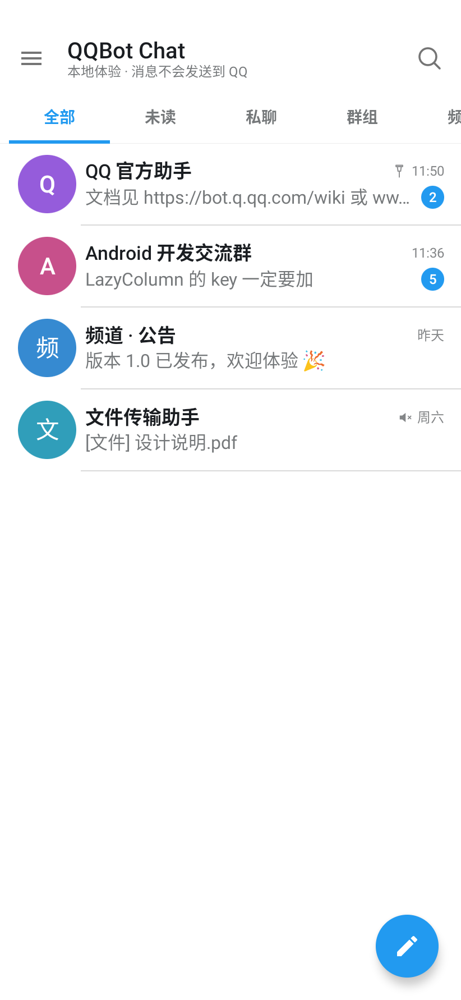
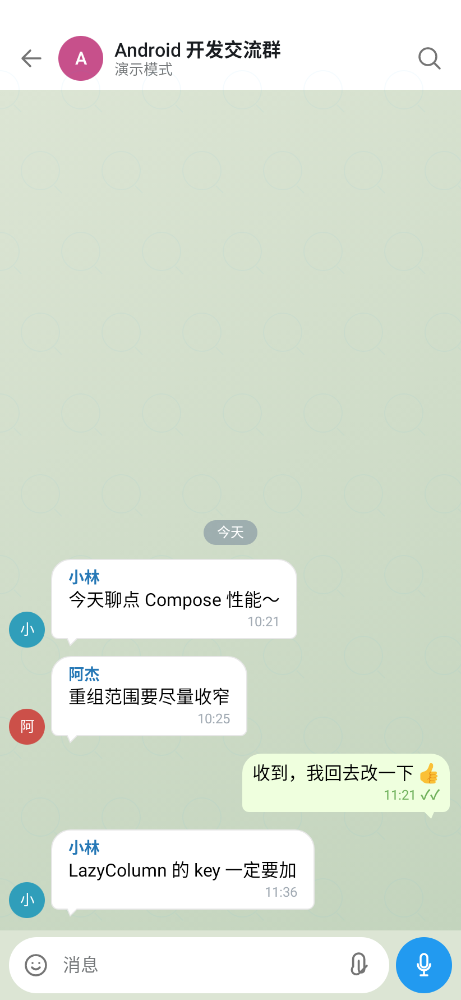
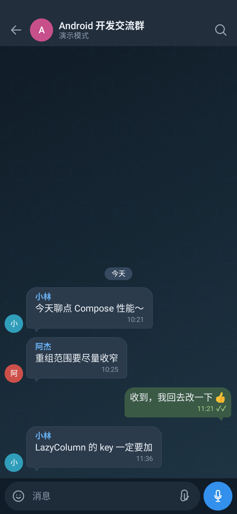
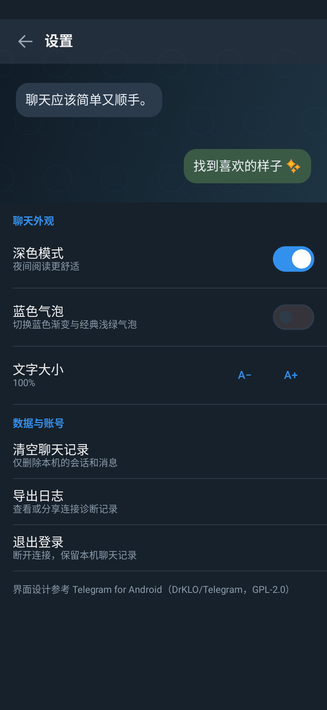

# QQBot Chat Android

对标 Telegram for Android 视觉规范的 **QQ 官方机器人聊天客户端**。直接在 App 内输入机器人 AppID / AppSecret，通过 QQ Bot API 与 WebSocket 网关收发消息，不依赖自建服务器。

> **预览版**：Telegram 风格的界面和交互，底层仍是 QQ 官方机器人 API。可从登录页进入独立的本地演示模式；本轮重构通过自动化测试，但未使用真实机器人凭证做 QQ 端到端验证。

## 截图

| 会话列表 | 浅色聊天 | 深色聊天 | 外观设置 |
| --- | --- | --- | --- |
|  |  |  |  |

截图来自 Android 12 模拟器的本地演示数据。重构范围、验证及待验证项见 [重构说明](docs/telegram-refactor.md)。

## 功能

### 消息
- **文本**：URL 自动识别、多行输入、每个会话独立的持久化草稿、失败重试
- **图片**：Coil 加载、本地发送预览、全屏缩放与拖动
- **视频 / 音频**：媒体卡片，有有效远程地址时交给系统应用打开
- **语音录制**：MediaRecorder（AAC/m4a）、计时与取消，离开前台自动取消录制
- **附件**：系统选择器按图片 / 视频 / 音频 / 文件分类，后台读取，单次最多 20 MB
- **按钮消息**：keyboard 按钮渲染与点击
- **表情回应**：频道消息调用 API 成功后更新徽章
- **引用回复**：滑动或长按回复、可关闭的引用条、跳转原消息
- **发送状态**：区分发送中、服务器已接收、失败、撤回；真实消息不伪造已读回执

### 会话与操作
- 会话抽屉、全部 / 未读 / 私聊 / 群组 / 频道分类、未读角标、草稿预览
- 搜索会话名、历史消息、草稿，包含归档会话；独立归档入口
- 长按会话：标记已读 / 置顶 / 静音 / 归档 / 删除
- 长按消息按能力展示操作；文本转发先选目标再确认，撤回成功后才隐藏内容
- 聊天内搜索、日期分隔、连续消息分组、回到最新消息；阅读历史时新消息不强制滚动
- 频道工具仅显示已接入的频道 / 子频道 / 置顶 / 日程 / 历史 / 日志操作
- 短距离页面转场、列表位置变化、回复与表情面板过渡、跟手滑动回复；见 [MOTION.md](MOTION.md)

### 设置
- 主题：浅色 / 深色 / 蓝色渐变气泡
- 字体缩放、聊天背景
- 清空记录、导出日志、退出登录

### 工程
- **数据持久化**：`filesDir/conversations.json` 原子写入，重启恢复；损坏自动备份
- **真实凭证校验**：登录时调 QQ `getAppAccessToken`，无效凭证拦在登录页
- **演示模式**：无需凭证即可体验聊天操作；演示会话与真实记录隔离，不写入真实记录
- **断线重连**：心跳 ACK 超时检测、指数退避、Gateway Resume

## 构建与测试

需要 JDK 17 和 Android SDK 35。仓库包含 Gradle 8.13 Wrapper（带发行包 SHA-256 校验），不依赖特定构建服务器。

```bash
./gradlew :core:test :app:testDebugUnitTest :app:assembleDebug :app:assembleRelease :app:lintDebug
# 有已连接的 Android 设备或模拟器时：
./gradlew :app:connectedDebugAndroidTest
```

Windows 使用 `gradlew.bat`。本地配置及原有远程构建脚本见 [BUILD_ENV.md](BUILD_ENV.md)。没有正式签名配置时，Release 构建按原有规则使用 debug 证书，不能覆盖正式签名的安装。

### 测试覆盖

本轮通过：**93 项核心测试、4 项 Robolectric UI 流程测试、5 项 Android 设备测试**。设备测试复用 4 个核心交互流程并额外导出浅色 / 深色截图；两种 UI 运行环境不代表 9 个不同业务场景。

| 测试类 | 数量 | 覆盖 |
| --- | --- | --- |
| `MessageParserTest` | 16 | @提及、表情标记、场景判定、媒体附件、按钮、引用 |
| `QQBotApiHttpTest` | 12 | token 缓存/刷新、三场景发送路径、被动回复字段、撤回四端点、403 异常 |
| `ChannelApiHttpTest` | 7 | guilds / channels / pins / schedules / history / reactions 路径 |
| `GatewayClientTest` + `GatewayClientProtocolTest` | 18 | op 10 Hello、Identify/Resume、心跳、ACK、op7/op9、dispatch 分发 |
| `ConversationStoreTest` | 11 | 会话增删改、未读、置顶、搜索、分页 |
| `ConversationStoreJsonTest` | 12 | 持久化往返、特殊字符、非法 JSON、版本、200×20 大批量 |
| `ChatExperienceTest` | 12 | 快照隔离、草稿、归档搜索、过滤、媒体识别、服务端 ID、引用 |
| `MessageDeliveryTest` | 5 | 切换会话期间发送、失败重试、发送序号、服务端 ID 撤回、撤回失败保留内容 |

共享 UI 流程覆盖：独立草稿与发送、归档搜索、转发目标与确认、表情输入和关闭回复。

## 技术栈

Kotlin 2.0.21 · Jetpack Compose · Material 3 · OkHttp · Gson · Coil · minSdk 26 / targetSdk 35

模块：`:core`（纯 Kotlin JVM：模型 / 解析 / REST / WebSocket / 存储，可跑单元测试）、`:app`（Android UI）

## 已知限制

- 单聊 / 群聊只能**被动回复**（需用户先发消息触发窗口），频道主动消息需机器人已加入频道
- 单聊 / 群聊**无官方历史消息接口**，断线期间依赖 Gateway Resume 补发
- 群聊主动 @ 提醒无法触发 QQ 的蓝色提及
- 群头像与成员头像：群消息事件不提供该字段
- 无后台推送（无 APNs/FCM 集成），锁屏或长时间后台会暂停 WebSocket
- 公告发布、频道成员列表等需更高权限的频道能力未实现
- 文本转发可用；媒体转发与失败附件自动重传尚未实现，失败附件需重新选择
- 尚无 Telegram 的语音/视频通话、秘密聊天、多端历史同步或用户账号体系；不能仅通过改界面获得这些服务端能力
- 搜索/表情面板可以正常返回关闭，但尚未接入跟随系统返回手势进度的预览；未测量 Release 帧耗时

## 许可

原创代码 [MIT License](LICENSE)。

UI 常量与气泡几何算法派生自 [Telegram for Android](https://github.com/DrKLO/Telegram)（**GPL-2.0**），
该部分受 GPL-2.0 约束，详见 [THIRD_PARTY_NOTICES.md](THIRD_PARTY_NOTICES.md)。

「QQ」「腾讯」为腾讯公司商标，本项目为第三方独立客户端，与腾讯无关联。
