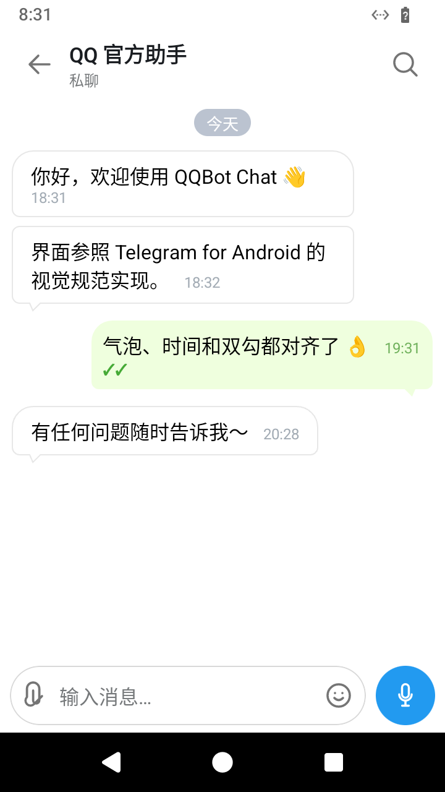
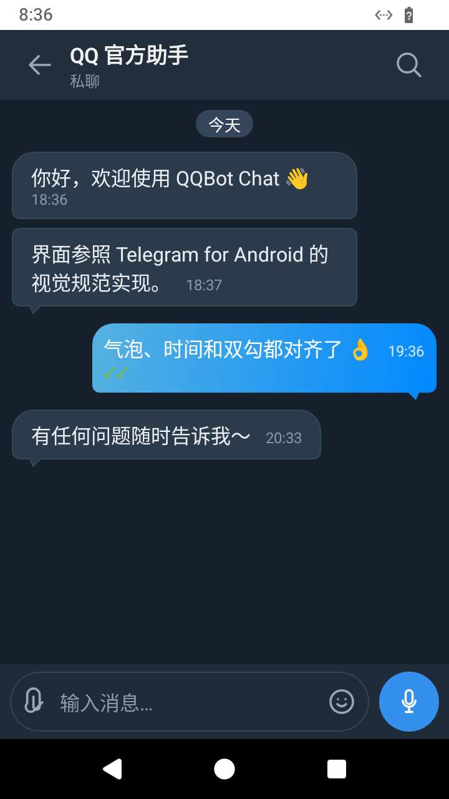
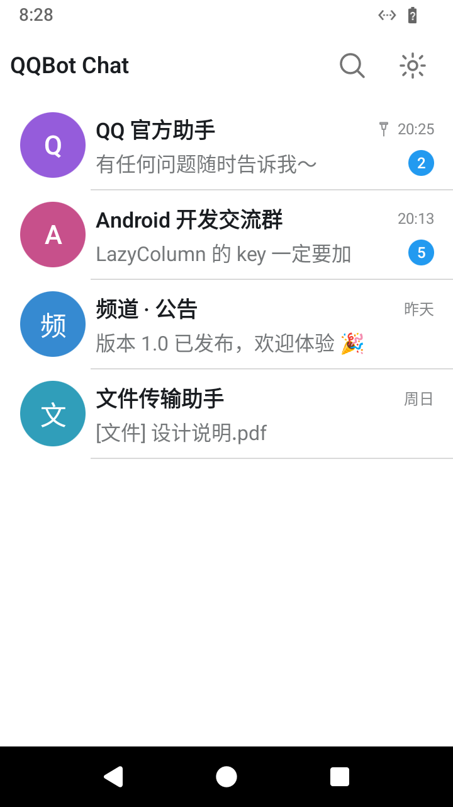
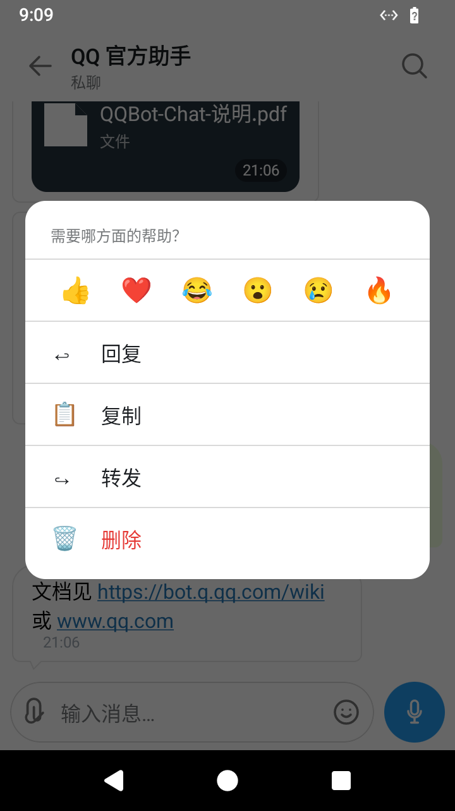
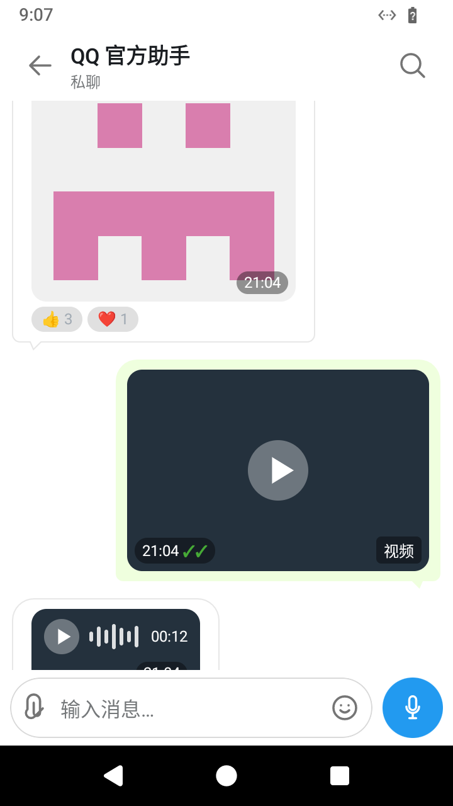
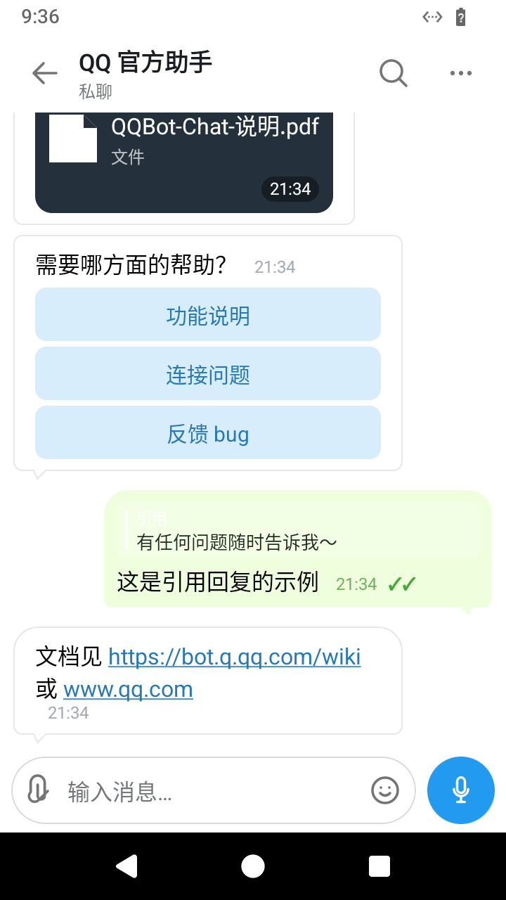
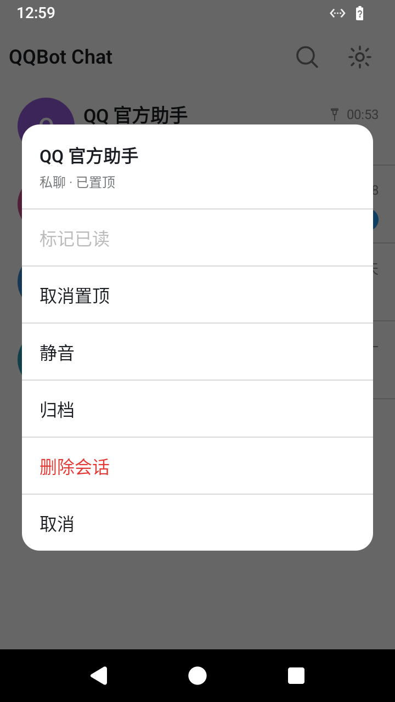
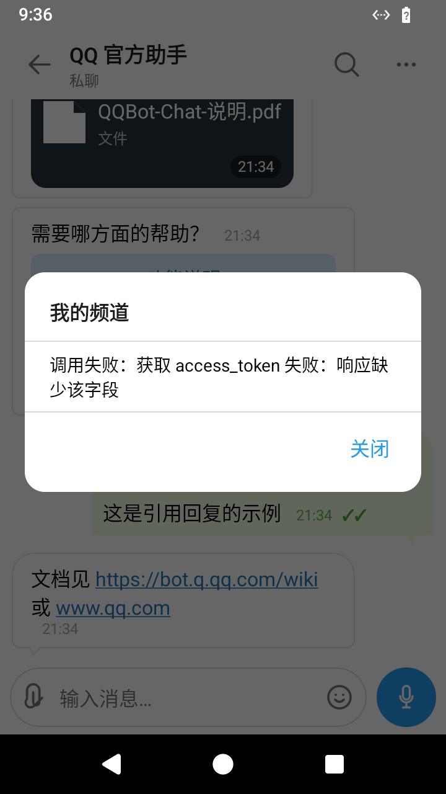

# QQBot Chat Android

对标 Telegram for Android 视觉规范的 **QQ 官方机器人聊天客户端**。直接在 App 内输入机器人 AppID / AppSecret，通过 QQ Bot API 与 WebSocket 网关收发消息，不依赖自建服务器。

> **预览版**：核心链路已在 Android 14 模拟器验证，但仍是半成品，请勿用于正式或重要沟通场景。

## 截图

| 聊天页 | 深色 + 蓝渐变 | 会话列表 | 消息操作 |
| --- | --- | --- | --- |
|  |  |  |  |

| 图片/视频/语音/表态 | 文件/按钮/引用/链接 | 会话长按 | 频道工具 |
| --- | --- | --- | --- |
|  |  |  |  |

## 功能

### 消息
- **文本**：Markdown、URL 自动识别为可点击链接、多行输入、草稿
- **图片**：Coil 加载、点击查看、接收缓存
- **视频**：缩略卡片 + 播放按钮
- **语音**：MediaRecorder 录制（AAC/m4a）、波形 + 时长显示
- **文件**：系统文件选择器、文件卡片
- **按钮消息**：keyboard 按钮渲染与点击
- **表情回应**：徽章展示（👍3 ❤️1）
- **引用回复**：引用条 + 跳转

### 会话与操作
- 多会话列表、搜索、未读角标、置顶
- 长按会话：标记已读 / 置顶 / 静音 / 归档 / 删除
- 长按消息：6 个表情回应 + 回复 / 复制 / 转发 / 撤回 / 删除
- 聊天内搜索消息、频道能力「更多」菜单（13 项）

### 设置
- 主题：浅色 / 深色 / 蓝色渐变气泡
- 字体缩放、聊天背景
- 清空记录、导出日志、退出登录

### 工程
- **数据持久化**：`filesDir/conversations.json` 原子写入，重启恢复；损坏自动备份
- **真实凭证校验**：登录时调 QQ `getAppAccessToken`，无效凭证拦在登录页
- **演示模式**：无需凭证即可浏览完整 UI
- **断线重连**：心跳 ACK 超时检测、指数退避、Gateway Resume

## 构建与测试

全部在服务器本地完成，**不使用 GitHub Actions**。

```bash
scripts/build_all.sh    # 同步 → 76 个 JVM 测试 → assembleDebug + assembleRelease → 取回 APK
```

环境（含 aarch64 上通过 qemu 运行 x86_64 aapt2 的方案）见 [BUILD_ENV.md](BUILD_ENV.md)。

### 测试覆盖

76 个 JVM 单元测试，全部通过：

| 测试类 | 数量 | 覆盖 |
| --- | --- | --- |
| `MessageParserTest` | 16 | @提及、表情标记、场景判定、媒体附件、按钮、引用 |
| `QQBotApiHttpTest` | 12 | token 缓存/刷新、三场景发送路径、被动回复字段、撤回四端点、403 异常 |
| `ChannelApiHttpTest` | 7 | guilds / channels / pins / schedules / history / reactions 路径 |
| `GatewayClientTest` + `GatewayClientProtocolTest` | 18 | op 10 Hello、Identify/Resume、心跳、ACK、op7/op9、dispatch 分发 |
| `ConversationStoreTest` | 11 | 会话增删改、未读、置顶、搜索、分页 |
| `ConversationStoreJsonTest` | 12 | 持久化往返、特殊字符、非法 JSON、版本、200×20 大批量 |

## 技术栈

Kotlin 2.0.21 · Jetpack Compose · Material 3 · OkHttp · Gson · Coil · minSdk 26 / targetSdk 35

模块：`:core`（纯 Kotlin JVM：模型 / 解析 / REST / WebSocket / 存储，可跑单元测试）、`:app`（Android UI）

## 已知限制

- 单聊 / 群聊只能**被动回复**（需用户先发消息触发窗口），频道主动消息需机器人已加入频道
- 单聊 / 群聊**无官方历史消息接口**，断线期间依赖 Gateway Resume 补发
- 群聊主动 @ 提醒无法触发 QQ 的蓝色提及
- 群头像与成员头像：群消息事件不提供该字段
- 无后台推送（无 APNs/FCM 集成），锁屏或长时间后台会暂停 WebSocket
- 公告发布、频道成员列表等需更高权限的频道能力未实现

## 许可

原创代码 [MIT License](LICENSE)。

UI 常量与气泡几何算法派生自 [Telegram for Android](https://github.com/DrKLO/Telegram)（**GPL-2.0**），
该部分受 GPL-2.0 约束，详见 [THIRD_PARTY_NOTICES.md](THIRD_PARTY_NOTICES.md)。

「QQ」「腾讯」为腾讯公司商标，本项目为第三方独立客户端，与腾讯无关联。
